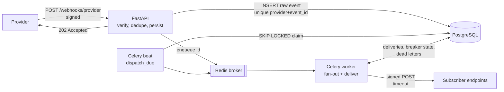
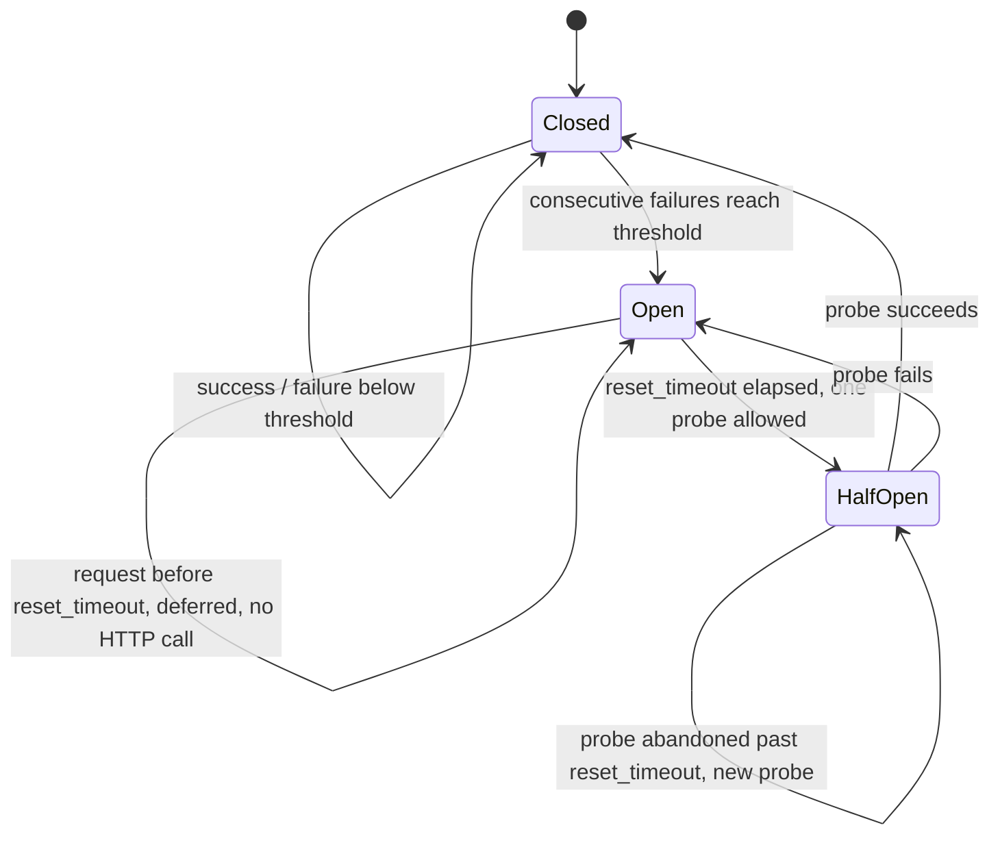

# hookrelay

Reliable webhook ingestion and delivery, built with FastAPI, SQLAlchemy 2, Celery and Redis.

hookrelay sits between webhook **providers** (payment gateways, shipping carriers, SaaS tools)
and your internal **subscribers**. It accepts inbound webhooks safely and fast, then delivers
them to subscriber endpoints with retries, backoff, a per-endpoint circuit breaker and a
dead-letter queue you can replay from.

## Why

Webhooks look simple and fail in boring, expensive ways:

- Providers retry when you are slow, so the same event arrives twice.
- An attacker can replay a captured request unless the signature covers a timestamp.
- Doing work inside the request makes the provider time out and retry again.
- A subscriber that is down gets hammered by synchronised retries, and its failures
  pile up in the queue for everyone else.
- Events that will never succeed disappear silently instead of landing somewhere visible.

hookrelay addresses each of these with a small, explicit mechanism.

## Architecture



**Inbound path.** `POST /webhooks/{provider}` reads the raw body, verifies an HMAC-SHA256
signature that covers `timestamp.body`, rejects timestamps outside a 5-minute window, and
inserts the raw event. A unique constraint on `(provider, event_id)` makes the database the
dedupe authority: a duplicate returns `200 {"status": "duplicate"}` without enqueueing anything.
The request returns `202` as soon as the row is committed; all further work is asynchronous.

**Fan-out.** A Celery task creates one `delivery` row per matching endpoint. `(event_id,
endpoint_id)` is unique, so a redelivered task cannot fan out twice.

**Delivery attempt.** Two short transactions around the HTTP call, never a lock held across
the network:

1. Lock the delivery and endpoint rows, ask the circuit breaker for permission, push
   `next_attempt_at` forward as a lease, commit.
2. `POST` with a timeout and an outbound signature (same scheme, endpoint's own secret).
3. Lock again, record the outcome, update the breaker, schedule the retry or dead-letter.

**Retries.** Each delivery stores `next_attempt_at`; a beat task claims due rows with
`SELECT ... FOR UPDATE SKIP LOCKED` and enqueues them. Retries are not scheduled with Celery
`countdown`/ETA (see design decisions).

### Response classification

| Result | Verdict | Effect |
|---|---|---|
| `2xx` | success | delivered, breaker reset |
| `5xx`, `408`, `425`, `429`, timeout, connection error | retry | backoff (or `Retry-After`), breaker failure |
| other `4xx`, `3xx` | fail | dead letter immediately; breaker **not** charged (the endpoint is up) |
| attempts reach `max_attempts` | — | dead letter with reason `max_attempts` |

Backoff is exponential with **full jitter**: `uniform(0, min(max_delay, base * 2^(n-1)))`.
A `Retry-After` header (seconds or HTTP-date) replaces the computed delay, capped at `max_delay`.

### Circuit breaker

One breaker per endpoint, stored on the endpoint row so every worker sees the same state.
The transition logic is a pure module (`hookrelay/breaker.py`).



While the breaker is open, due deliveries are **deferred**, not attempted: they do not consume
an attempt and are rescheduled for when the breaker may half-open. One sick subscriber cannot
burn its own retry budget or the workers' time.

## Project layout

```
src/hookrelay/
  signature.py   HMAC-SHA256 sign/verify, timestamp tolerance, secret rotation   (pure)
  retry.py       classification, full-jitter backoff, Retry-After parsing         (pure)
  breaker.py     closed/open/half-open state machine                              (pure)
  delivery.py    fan-out, delivery attempt, due-row claiming, replay
  tasks.py       Celery app and thin task wrappers
  api.py         FastAPI routes
  models.py      SQLAlchemy 2 models
```

## Quick start

```bash
docker compose up --build
```

This starts the API on `localhost:8000`, a Celery worker with embedded beat, Redis and
PostgreSQL. Tables are created on API startup.

Register a subscriber:

```bash
curl -s -X POST localhost:8000/endpoints \
  -H 'X-Admin-Token: dev-admin-token' -H 'Content-Type: application/json' \
  -d '{"url": "https://example.com/hooks", "secret": "endpoint-secret-0123456789",
       "event_types": ["invoice.paid"]}'
```

Send a signed webhook as provider `acme` (secret `whsec_dev_secret` in compose):

```bash
BODY='{"id":"evt_123","type":"invoice.paid","amount":4200}'
TS=$(date +%s)
SIG=$(printf '%s.%s' "$TS" "$BODY" | openssl dgst -sha256 -hmac 'whsec_dev_secret' | awk '{print $NF}')

curl -s -X POST localhost:8000/webhooks/acme \
  -H "X-Hookrelay-Signature: t=$TS,v1=$SIG" -H 'Content-Type: application/json' \
  -d "$BODY"
# {"status":"accepted","id":1}

# Same request again
# {"status":"duplicate","event_id":"evt_123"}
```

Inspect and replay dead letters:

```bash
curl -s localhost:8000/admin/dead-letters -H 'X-Admin-Token: dev-admin-token'
curl -s -X POST localhost:8000/admin/dead-letters/1/replay -H 'X-Admin-Token: dev-admin-token'
```

### Configuration

| Variable | Default | Meaning |
|---|---|---|
| `HOOKRELAY_DATABASE_URL` | `sqlite:///./hookrelay.db` | SQLAlchemy URL |
| `HOOKRELAY_REDIS_URL` | `redis://localhost:6379/0` | Celery broker |
| `HOOKRELAY_PROVIDER_SECRETS` | `{}` | `{"acme": "s1"}` or `{"acme": ["new", "old"]}` for rotation |
| `HOOKRELAY_ADMIN_TOKEN` | `change-me` | header `X-Admin-Token` for admin routes |
| `HOOKRELAY_SIGNATURE_TOLERANCE` | `300` | seconds of allowed clock skew / replay window |
| `HOOKRELAY_DELIVERY_TIMEOUT` | `10` | outbound HTTP timeout, seconds |
| `HOOKRELAY_MAX_ATTEMPTS` | `8` | attempts before dead-lettering |
| `HOOKRELAY_BASE_DELAY` / `HOOKRELAY_MAX_DELAY` | `2` / `3600` | backoff base and cap, seconds |
| `HOOKRELAY_BREAKER_THRESHOLD` | `5` | consecutive failures that open the breaker |
| `HOOKRELAY_BREAKER_RESET_SECONDS` | `60` | open duration before a half-open probe |
| `HOOKRELAY_DISPATCH_INTERVAL` | `5` | beat interval for `dispatch_due`, seconds |
| `HOOKRELAY_CELERY_EAGER` | `false` | run tasks inline (tests) |

## Design decisions

- **The database is the source of truth, the broker is a doorbell.** Every message carries
  only an id. Losing a message delays work; it never loses it. `dispatch_due` also re-enqueues
  inbound events that were committed but never processed (for example, the broker was down
  during the request).
- **Dedupe with a unique constraint, not a lookup.** Check-then-insert races under concurrent
  provider retries; `INSERT` + `IntegrityError` does not.
- **Retries in the table, not in Celery ETA.** With Redis, ETA tasks are held in worker memory
  and are redelivered after `visibility_timeout`, which makes hour-long backoffs fragile and can
  duplicate them. A `next_attempt_at` column plus `FOR UPDATE SKIP LOCKED` is visible,
  queryable and safe with several dispatchers.
- **`acks_late` + `task_reject_on_worker_lost`, `prefetch_multiplier=1`.** A worker that dies
  mid-task returns the message to the queue. This is at-least-once delivery, so every task is
  idempotent: fan-out is unique per pair, and an attempt on a non-pending delivery is skipped.
- **No lock across the network.** The attempt is split into claim / call / record so a slow
  subscriber never holds row locks; the lease on `next_attempt_at` keeps other workers away.
- **4xx does not trip the breaker.** A `400` proves the endpoint is alive; the breaker tracks
  availability, not correctness of our payload.
- **Pure core.** Signature, retry policy and breaker have no I/O and take the clock as an
  argument, so their edge cases are covered by fast unit tests.
- **Subscribers get at-least-once delivery.** They should dedupe on `X-Hookrelay-Event-Id`.

What is deliberately **not** here: per-endpoint ordering guarantees, multi-tenant auth, a UI,
and schema migrations (tables are created with `create_all`; a production deployment would add
Alembic).

## Running tests

```bash
python3 -m venv .venv
.venv/bin/pip install -e ".[dev]"
.venv/bin/ruff check .
.venv/bin/pytest
```

The suite uses in-memory SQLite, Celery in eager mode and `httpx.MockTransport`, so it needs no
Redis, PostgreSQL or network. Time is injected through a fake clock, so backoff and breaker
timeouts are tested without sleeping.

## License

MIT, see [LICENSE](LICENSE). Copyright (c) 2026 Ahmed Mahdy.
